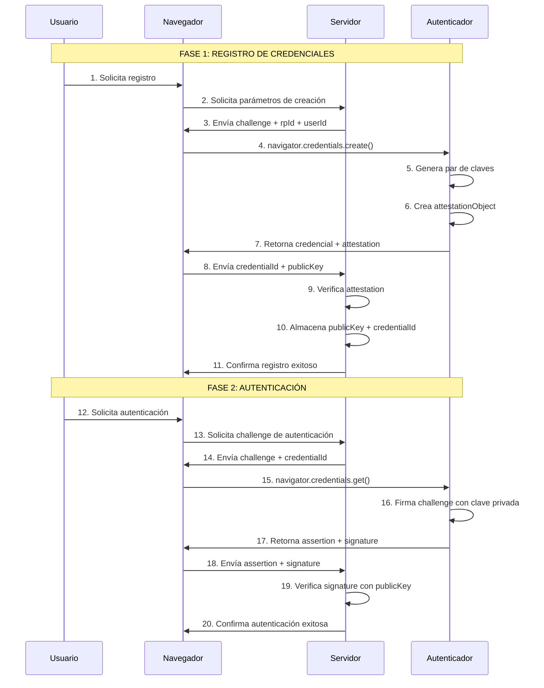

webauthn by [Esimios](https://github.com/ESIMIOS)

---  
# Utilitades para el uso de Webauthn (registro, autenticación y firmado con typescript)

Para el uso de esta librería, tomar en cuenta que se utiliza el estándar WebAuthn L1 para un caso de uso en particular:  

* El uso de dispositivos criptográficos autenticadores por hardware portátiles (Llaves FIDO 2 USB, NFC o BLE) que se comunica con el Navegador utilizando el protocolo CTAP (Client to Authenticator Protocol) de FIDO.  

* El valor de authenticatorAttachment se espera como 'cross-platform'

* Los parámetros para la creación de las llaves **pubKeyCredParams** utilizan el algoritmo -7 (COSE), que es ES256 (SHA256withECDSA utilizndo la curva P-256)

* **requireResidentKey** no es requerido (por el momento, pero esto cambiará para permitir llaves residentes e implementar una autenticación passwordless)

* El tipo de **attestation** es 'direct'

* El formato de la respuesta esperada por los autenticadores es 'packed'

* Los transportes esperados para los autenticadores son ["usb", "nfc", "ble"]

* No se utilizan extensiones en los autenticadores


# WebAuthn / FIDO2 - Mecanismo de Autenticación

Mecanismo de registro y validación de credenciales FIDO2/WebAuthn para autenticación sin contraseñas utilizando credenciales criptográficas.

## Mecanismo de Registro y Validación de Credenciales FIDO2/WebAuthn

### Diagrama de Flujo




### Componentes del Sistema

#### 1. **Usuario (User)**
- Inicia los procesos de registro y autenticación
- Interactúa con el autenticador FIDO2 (biometría, PIN, etc.)

#### 2. **Navegador (Browser)**
- Implementa la API WebAuthn
- Maneja la comunicación entre servidor y autenticador
- Procesa los datos criptográficos

#### 3. **Servidor (Relying Party)**
- Almacena las claves públicas de los usuarios
- Genera challenges únicos
- Verifica las firmas criptográficas

#### 4. **Autenticador FIDO2**
- Dispositivo de seguridad (USB, NFC, Bluetooth)
- Almacena claves privadas de forma segura
- Realiza operaciones criptográficas

### Estructura de Datos

#### Parámetros de Creación de Credenciales
```javascript
const publicKeyCredentialCreationOptions = {
    challenge: Uint8Array,           // Desafío aleatorio del servidor
    rp: {                           // Relying Party
        name: "COFEPRIS TRÁMITES DIGITALES",
        id: "localhost"
    },
    user: {                         // Información del usuario
        id: Uint8Array,            // ID único del usuario
        name: "MART810609HDFRYR03",
        displayName: "Tirso Martínez"
    },
    pubKeyCredParams: [{            // Algoritmos soportados
        alg: -7,                   // ES256 (ECDSA con SHA-256)
        type: "public-key"
    }],
    authenticatorSelection: {
        authenticatorAttachment: "cross-platform",
        userVerification: "required"
    },
    timeout: 60000,
    attestation: "direct"
}
```

#### Estructura de AttestationObject
```
AttestationObject {
    fmt: "packed",                 // Formato de attestation
    attStmt: {                     // Statement de attestation
        alg: -7,                   // Algoritmo de firma
        sig: Uint8Array,          // Firma del autenticador
        x5c: Array                // Certificados (opcional)
    },
    authData: {                    // Datos de autenticación
        rpIdHash: Uint8Array,     // Hash del ID del RP
        flags: Uint8Array,        // Flags de estado
        counter: Uint8Array,      // Contador de uso
        aaguid: Uint8Array,       // ID del autenticador
        credentialId: Uint8Array, // ID de la credencial
        credentialPublicKey: Uint8Array // Clave pública en formato COSE
    }
}
```

#### Parámetros de Autenticación
```javascript
const publicKeyCredentialRequestOptions = {
    challenge: Uint8Array,         // Desafío del servidor
    allowCredentials: [{           // Credenciales permitidas
        id: Uint8Array,           // ID de credencial específica
        type: 'public-key',
        transports: ['usb', 'ble', 'nfc']
    }],
    timeout: 60000
}
```

### Proceso de Verificación de Firma

1. **Construcción del Hash Base:**
   ```
   signatureBase = rpIdHash + flags + counter + clientDataHash
   ```

2. **Verificación Criptográfica:**
   - Se utiliza la clave pública almacenada
   - Se verifica la firma ECDSA con curva P-256
   - Se valida que el challenge coincida

3. **Validaciones de Seguridad:**
   - Verificación del rpIdHash
   - Validación del contador (anti-replay)
   - Verificación de flags de estado

### Características de Seguridad

- **Autenticación sin contraseñas:** Elimina la necesidad de contraseñas tradicionales
- **Resistencia a phishing:** Las credenciales están vinculadas al dominio
- **Protección contra ataques de replay:** Uso de challenges únicos y contadores
- **Almacenamiento seguro:** Las claves privadas nunca salen del autenticador
- **Verificación de usuario:** Requiere interacción física (biometría, PIN, etc.)

### Tecnologías Criptográficas Utilizadas

- **WebAuthn API:** Estándar del navegador para autenticación
- **CBOR:** Codificación de datos binarios
- **ECDSA P-256:** Algoritmo criptográfico de firma digital
- **SHA-256:** Función hash criptográfica
- **COSE:** Formato estándar para claves públicas


